<picture>
  <source media="(prefers-color-scheme: dark)"  srcset="assets/hero-dark.webp">
  <source media="(prefers-color-scheme: light)" srcset="assets/hero-light.webp">
  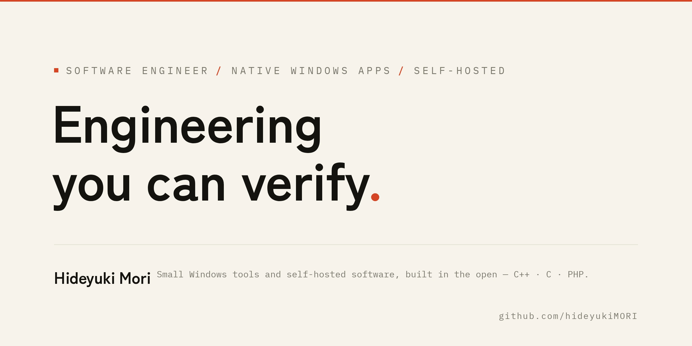
</picture>

# Hideyuki Mori

### Software engineer. I build small Windows desktop tools, terminal apps, and self-hosted business software in the open, and I put the proof next to every claim.

**[NeNe Folio is on the Microsoft Store](https://apps.microsoft.com/detail/9PCHS225SWBX)** — a small Markdown notebook for Windows, built in plain C, with Mermaid diagrams and images. **1.3.1**, now on the Store, brings bug fixes and performance work on long notes. It joins NeNe Loupe, NeNe Clock and NeNe Ruler: **four apps available on the Store**.

My current work spans **Windows desktop tools**, **Swift terminal apps for WSL2**, and the **NENE2 family of self-hosted business software**. [NeNe Nib](#nene-nib--a-fast-text-editor-that-toggles-between-ordinary-and-vim-editing), my ordinary/Vim text editor, published **beta.8** on 4 November with opt-in language-server diagnostics and a folder explorer. The newest desktop project is **[NeNe Ledger](https://github.com/hideyukiMORI/nene-ledger)**, a CSV / TSV editor in Rust that opened its public repository the same day. The terminal family includes a news ticker as well as games; NeNe Summit is at the design stage. The links below distinguish released software from work in progress.

日本語: ソフトウェアエンジニア。Markdown ノートアプリ <strong>NeNe Folio（Mermaid 図・画像対応）を Microsoft Store で公開中。不具合修正と処理改善の 1.3.1 が Store に出ました</strong>。Loupe・Clock・Ruler に続く4本目です。Windows 向けデスクトップアプリ、WSL2 向けの Swift 製端末アプリ、自己ホスト型業務ツール群 NENE2 を公開開発しています。テキストエディタ NeNe Nib は 11 月 4 日に beta.8 を公開。同日に CSV / TSV エディタ NeNe Ledger（Rust）の公開リポジトリを開きました。端末アプリにはニュース表示の Wire が加わり、登山アクションの Summit は設計段階です。

Repository and release status checked: 6 November 2026.

---

## NeNe Folio — now on the Microsoft Store

**[Get NeNe Folio from the Microsoft Store](https://apps.microsoft.com/detail/9PCHS225SWBX?hl=ja-jp&gl=JP)** · [Source code](https://github.com/hideyukiMORI/nene-folio) · Windows 10 version 2004 or later, x64 · Free

A frameless Markdown notebook for everyday notes, reading logs and ideas. Organize notes in coloured categories, edit the Markdown source, and switch to a readable view of headings, lists, tables, quotes and code blocks. Written in **C23 and Win32, without a UI library**.

  <a href="https://apps.microsoft.com/detail/9PCHS225SWBX">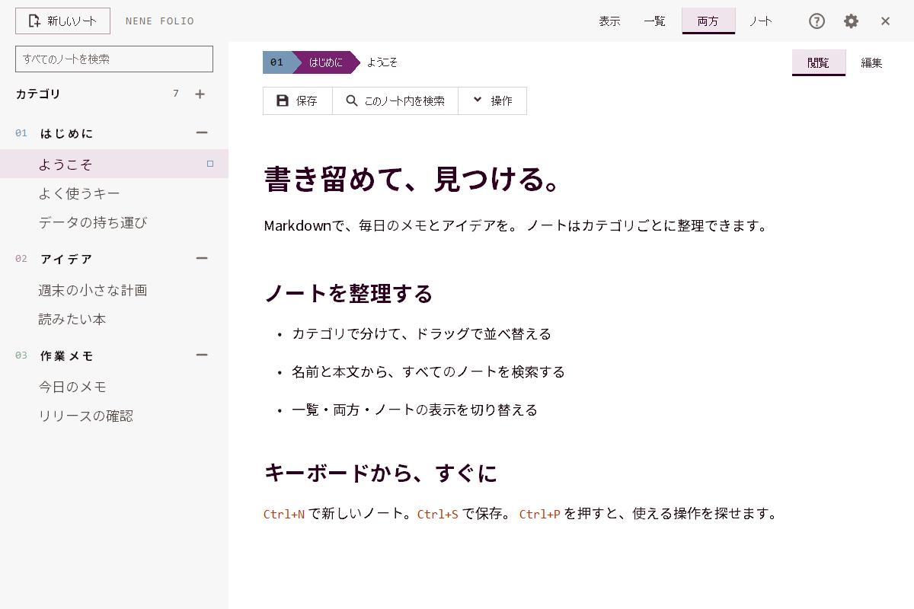</a>

Application screenshot from the repository's v0.2.0 showcase. See the Store listing for the current release.

- **Keep your notes as files.** Markdown in a folder you choose; no account, ads or usage tracking.
- **Find and organize.** Search note names and bodies, search within a note, use regex replacement, and drag notes into order.
- **Recover an earlier draft.** Keep up to five pre-save versions and restore one into the editor.
- **Make it comfortable.** Preview themes, zoom the note, choose list / note / combined views, and use keyboard commands. 日本語 / English / 简体中文 UI.
- **Diagrams and images (1.3.0).** Mermaid flowcharts and sequence diagrams rendered in the note's theme, PNG / JPEG images, syntax colours in code blocks, and ZIP export that bundles referenced images.
- **Fixes and speed (1.3.1).** Save history no longer advances when preparing the view fails before saving, invalid settings values are rejected more strictly, and line indexing, Markdown parsing and in-note search do less work on long notes. Note format and settings are unchanged.

The **Store app is the main download** and is at **1.3.1** (checked 6 November 2026). The same version is also on GitHub as an **[unsigned portable ZIP](https://github.com/hideyukiMORI/nene-folio/releases/tag/v1.3.1)** with `SHA256SUMS` for people who prefer not to use the Store.

---

## NeNe Nib — a fast text editor that toggles between ordinary and Vim editing

**[github.com/hideyukiMORI/nene-nib](https://github.com/hideyukiMORI/nene-nib)** · Windows 11 x64 · **Beta — [download v0.1.0-beta.8](https://github.com/hideyukiMORI/nene-nib/releases/tag/v0.1.0-beta.8)** (4 November 2026 · a ZIP with `SHA256SUMS`; extract and run `NeNeNib.exe`, no installer and no runtime)

  <a href="https://github.com/hideyukiMORI/nene-nib">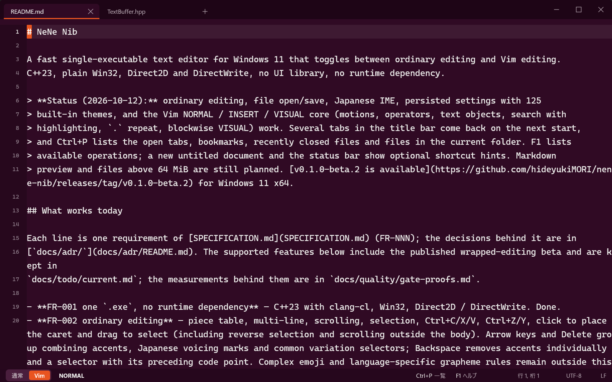</a>

One executable. C++23, plain Win32, Direct2D and DirectWrite — no UI library, no runtime dependency. It edits like Notepad until you flip one switch in the status bar; then it is Vim.

  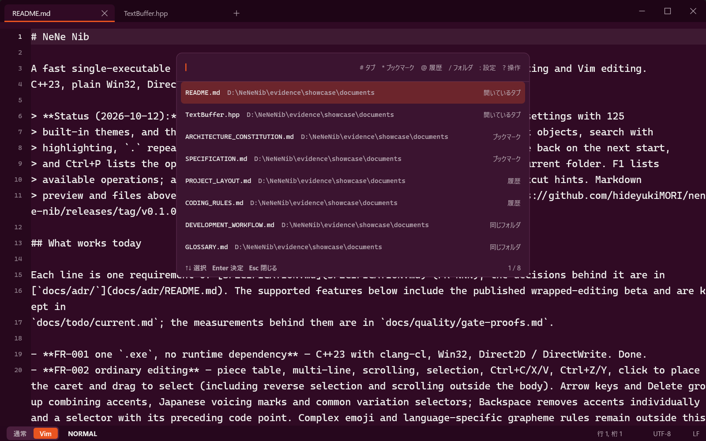
  &nbsp;
  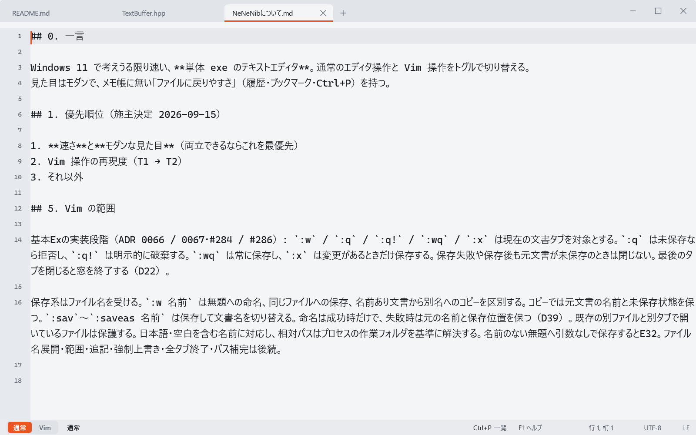

Real windows, captured from a development build at the default font and size — <a href="https://github.com/hideyukiMORI/nene-nib/blob/main/docs/quality/showcase-2026-10-12.md">capture details</a>.

### Colour themes

  <a href="https://github.com/hideyukiMORI/nene-nib#find-your-theme">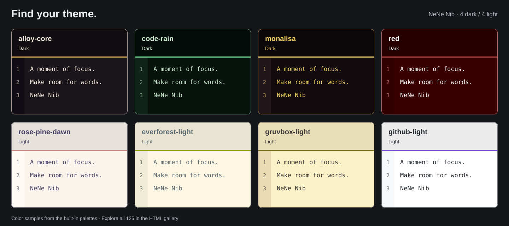</a>

Eight favourites out of **125 built-in colour schemes** — the 28 standard Vim names, VS Code defaults and popular IDE palettes, MonaLisa, and film-inspired originals. Switch with `:colorscheme <name>` or from Ctrl+P. [All theme names and sources](https://github.com/hideyukiMORI/nene-nib/blob/main/docs/design/2026-10-12-colorschemes.md) · [offline gallery (HTML)](https://github.com/hideyukiMORI/nene-nib/blob/main/docs/design/colorschemes.html)

The image shows colour samples, not application screenshots. All 125 schemes ship in the beta.

| | |
| --- | --- |
| **Two ways to edit, one toggle** | Ordinary editing (selection, clipboard, undo/redo, mouse) or Vim NORMAL / INSERT / VISUAL — motions, operators, counts, text objects, registers, macros, marks, `.` repeat, blockwise VISUAL, search with highlighting. Switch with the status bar or Ctrl+Shift+Space. |
| **A Vim engine written from scratch, checked against real Vim** | **Fixtures generated by Vim 9.1** are replayed in the test suite, including wrapped-text movement. Randomized differential tests against real Vim found and fixed **40+ behavioural differences** before beta.8. [Current development record](https://github.com/hideyukiMORI/nene-nib/blob/main/docs/todo/current.md). |
| **Japanese from day one** | IME composition drawn in place; Vim NORMAL turns the IME off and INSERT turns it back on. UTF-8, UTF-8 BOM, UTF-16 and Shift_JIS; CRLF / LF kept as read. |
| **Tabs, splits and Ctrl+P** | Tabs live in the title bar and come back on the next start with caret and scroll position. Two-pane splits, side by side or stacked. Ctrl+P fuzzy-finds open tabs, bookmarks, recently closed files, and files in the current folder. Unsaved edits are autosaved every 30 seconds. |
| **Syntax and Markdown** | Syntax highlighting for **28 languages** (C / C++, C#, Rust, Go, Python, PHP, TypeScript, SQL, shell, PowerShell, GDScript …). Live Markdown preview in the next pane (Ctrl+Shift+M); HTML from the browser pastes as Markdown. |
| **Look** | Frameless window with a Mica title bar, follows the OS light / dark theme. **125 built-in colour schemes** (`:colorscheme`), plus user themes. Line wrapping, font size on Ctrl + wheel. |
| **Speed, measured** | Medians on the reference machine: first frame 42 ms (190 ms in beta.3), window visible 32 ms, one keystroke 0.6 ms, a 16 MiB file opens in 50 ms. A speed gate of eight benchmarks runs before every release. The script and reference values are in the repo. |
| **New in beta.8** (4 November) | Opt-in **language-server diagnostics** (clangd via `settings.v4`: squiggles, a count in the status bar, the message for the caret line). Notepad-style keys in ordinary mode: find / replace / go-to-line (Ctrl+F / Ctrl+H / Ctrl+G), print, selectable save encoding and line endings. A **folder explorer** pane, full-window Markdown preview with clickable task checkboxes, `map` / `nmap` / `inoremap` and more Vim staples (`gv`, `Ctrl-a` / `Ctrl-x`, jump list, blockwise `I` / `A` / `c`). Time to screen 37 → 14.5 ms, long Japanese lines 1.9 → 1.0 ms per keystroke; files up to 1 GiB open. [Release notes](https://github.com/hideyukiMORI/nene-nib/releases/tag/v0.1.0-beta.8). |
| **Not yet** | `:s` / `:g`, language colours inside Markdown code blocks, LSP completion and go-to-definition (diagnostics only, one language at a time). No code signing, installer, or auto-update in the beta. |

Every feature is one numbered requirement in [`SPECIFICATION.md`](https://github.com/hideyukiMORI/nene-nib/blob/main/SPECIFICATION.md); the decisions are in [`docs/adr/`](https://github.com/hideyukiMORI/nene-nib/tree/main/docs/adr) and the measurements in [`docs/quality/gate-proofs.md`](https://github.com/hideyukiMORI/nene-nib/blob/main/docs/quality/gate-proofs.md).

---

## More Windows apps

Desktop tools with different native stacks, from plain Win32 to Swing and WinUI. **NeNe Folio, NeNe Loupe, NeNe Clock and NeNe Ruler are on the Microsoft Store.**

  <a href="https://apps.microsoft.com/detail/9N6HZB1SXKBM">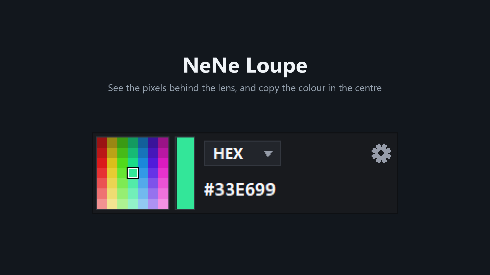</a>
  &nbsp;
  <a href="https://github.com/hideyukiMORI/nene-clock">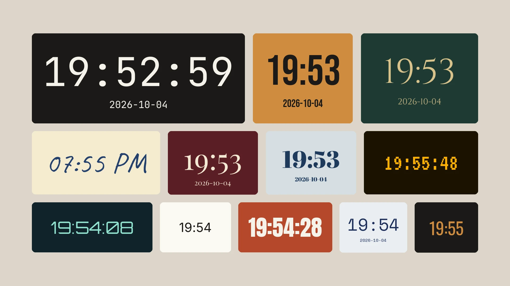</a>
  &nbsp;
  <a href="https://github.com/hideyukiMORI/nene-ruler">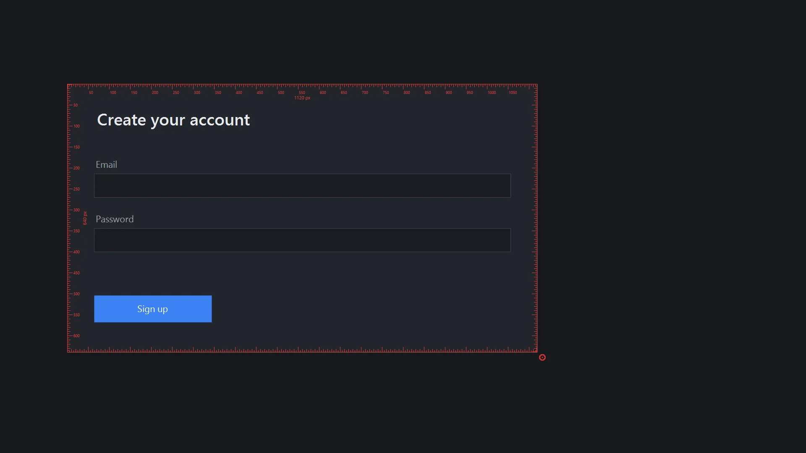</a>

| App | What it is | Built with | Status |
| --- | --- | --- | --- |
| **[NeNe Loupe](https://github.com/hideyukiMORI/nene-loupe)** | A tiny frameless screen loupe and colour picker. See the pixels behind the lens, copy the colour in the centre. | C++23 · Win32 | **On the [Microsoft Store](https://apps.microsoft.com/detail/9N6HZB1SXKBM)** · [v1.0.0](https://github.com/hideyukiMORI/nene-loupe/releases/latest) · portable ZIP also available |
| **[NeNe Clock](https://github.com/hideyukiMORI/nene-clock)** | A quiet desktop clock. No frame, no buttons, no tray icon — just the time, in the typeface and colours you choose. | Java 21 · Swing (runtime bundled) | **On the [Microsoft Store](https://apps.microsoft.com/detail/9N5G1ZXK0MV7)** · [latest release](https://github.com/hideyukiMORI/nene-clock/releases/latest) — Windows installer, portable ZIP, Ubuntu `.deb` |
| **[NeNe Ruler](https://github.com/hideyukiMORI/nene-ruler)** | A frameless on-screen ruler. Lay a transparent frame over anything and read its width and height in physical pixels; click a number to copy it. | Rust · Win32 + Direct2D (Linux: x11rb + cairo) | **On the [Microsoft Store](https://apps.microsoft.com/detail/9N6JVHKL9LM3)** · [latest release](https://github.com/hideyukiMORI/nene-ruler/releases/latest) — Windows MSI, portable ZIP, Ubuntu `.deb`, Linux ZIP |
| **[NeNe Folio](https://github.com/hideyukiMORI/nene-folio)** | A frameless Markdown notebook with a category drawer. View and edit (tables, nested lists, checklists), Mermaid diagrams and images, a short history of every save, search and regex replace, Vim-like keys; UI in 日本語 / English / 简体中文. | C23 · Win32 | **On the [Microsoft Store](https://apps.microsoft.com/detail/9PCHS225SWBX)** (1.3.1) · [v1.3.1 portable ZIP](https://github.com/hideyukiMORI/nene-folio/releases/tag/v1.3.1) on GitHub |
| **[NeNe Commander](https://github.com/hideyukiMORI/NeNeCommander)** | A keyboard-first dual-pane file manager; Windows, UNC, and WSL paths as typed, explicit boundaries. | C# · .NET 10 · WinUI 3 | In development — local / WSL file operations on `main`; UNC mutations and on-screen release confirmation remain · no release yet |
| **[NeNe Docket](https://github.com/hideyukiMORI/NeNeDocket)** | A folder-based issue tracker with undo, per-account journals, history and optional signed permissions; no server. | Rust · Win32 + Direct2D / x11rb + cairo | In development — X11 operation verified; Windows build compiles but has not yet been run on Windows · no release yet |
| **[NeNe Ledger](https://github.com/hideyukiMORI/nene-ledger)** | A CSV / TSV editor that stays fast on huge files and never changes data on its own: cells are text (`00123` stays `00123`), untouched rows are written back byte for byte, heavy work runs in the background. Public repository opened 4 November 2026. | Rust · Win32 + Direct2D / x11rb + cairo | In development — opening, viewing, selecting, copying and summing work on X11 and on Windows (dialect and encoding detection scored 9.66 on the 2,290-file Pollock benchmark); editing and saving not started · no release yet · custom licence (free use, no sale) |

**How they are built.** Each repository starts from a specification, an architecture constitution, and a test strategy before the first feature. The rule is the same in every one: *every meaning has exactly one canonical implementation path, and the compiler, the build graph, static analysis, and CI enforce that — not memory.*

Also outside the web stack: **[NENE-PIXEL](https://github.com/hideyukiMORI/NENE-PIXEL)** (Kotlin · Android — pixel drawing tool with indexed palettes and up to 16 layers, in development) · **[xi-tools](https://github.com/hideyukiMORI/xi-tools)** (Rust — `scopegrep`, `fleet-top`) · **[nene-recall](https://github.com/hideyukiMORI/nene-recall)** (Go · pgvector — local hybrid retrieval API)

---

## Terminal apps in Swift for WSL2

Terminal apps for Ubuntu on WSL2 in Windows Terminal: AI-played game screensavers, an interactive falling-sand game, and a news ticker. The game screensavers pair hand-written AIs with character banter; Wire fetches headlines and can translate them locally. Eight apps have published releases; Delve and Summit are still in development.

  <a href="https://github.com/hideyukiMORI/nene-gambit">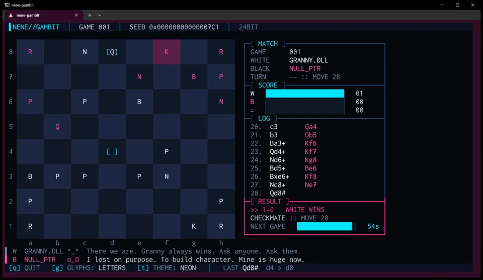</a>
  &nbsp;
  <a href="https://github.com/hideyukiMORI/nene-swarm">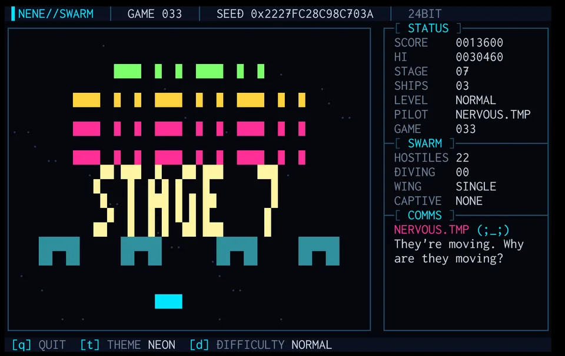</a>
  &nbsp;
  <a href="https://github.com/hideyukiMORI/nene-bolt">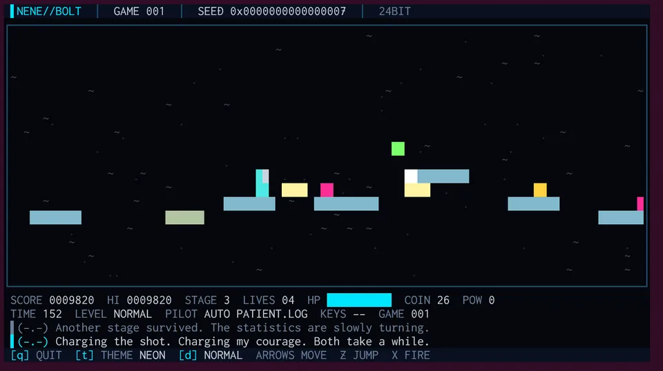</a>

  <a href="https://github.com/hideyukiMORI/nene-igo">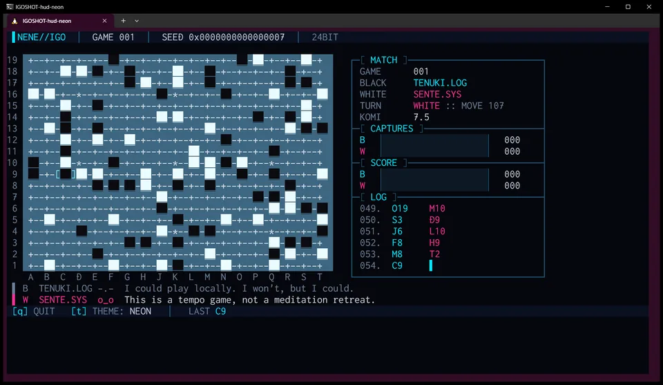</a>
  &nbsp;
  <a href="https://github.com/hideyukiMORI/nene-poker">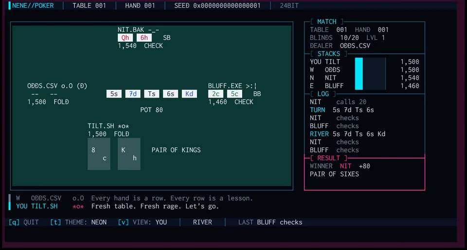</a>
  &nbsp;
  <a href="https://github.com/hideyukiMORI/nene-sand">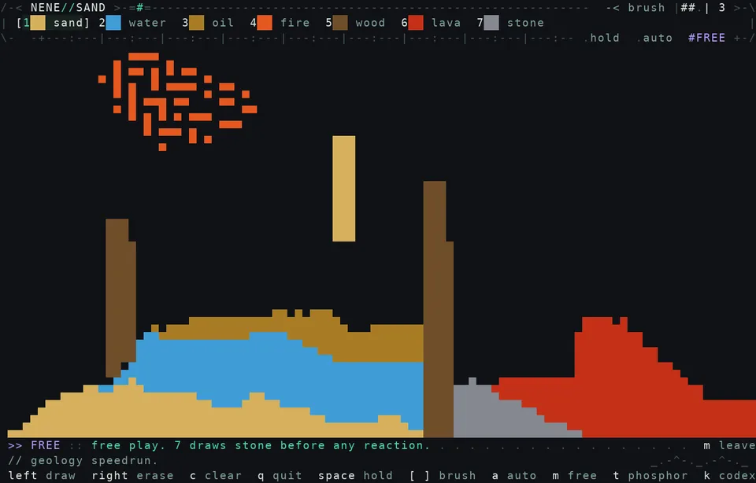</a>

Screenshots from each repository, taken in Windows Terminal on WSL2.

| App | What it is | Status |
| --- | --- | --- |
| **[NeNe Gambit](https://github.com/hideyukiMORI/nene-gambit)** | Chess. A hand-written chess AI plays game after game; same `--seed`, same games, same banter. | [v0.1.1](https://github.com/hideyukiMORI/nene-gambit/releases/latest) |
| **[NeNe Reversi](https://github.com/hideyukiMORI/nene-reversi)** | Reversi, with commentary on every stolen corner. | [v0.1.0 beta](https://github.com/hideyukiMORI/nene-reversi/releases/latest) |
| **[NeNe Igo](https://github.com/hideyukiMORI/nene-igo)** | Go on a 19×19 board, with a hand-written Monte Carlo tree search. | [v0.1.0](https://github.com/hideyukiMORI/nene-igo/releases/latest) |
| **[NeNe Poker](https://github.com/hideyukiMORI/nene-poker)** | No-limit Texas hold'em at one table of four AIs. Imaginary chips, no money involved. | [v0.1.0](https://github.com/hideyukiMORI/nene-poker/releases/latest) |
| **[NeNe Swarm](https://github.com/hideyukiMORI/nene-swarm)** | A fixed-screen shooter: a marching, diving swarm, shields, a capture beam, bonus stages, a top-five high score. | [v0.1.0 beta](https://github.com/hideyukiMORI/nene-swarm/releases/latest) |
| **[NeNe Bolt](https://github.com/hideyukiMORI/nene-bolt)** | A side-scrolling action platformer, four stages and a boss. Press an arrow key and you take over from the AI. | [v0.1.0 beta](https://github.com/hideyukiMORI/nene-bolt/releases/latest) |
| **[NeNe Sand](https://github.com/hideyukiMORI/nene-sand)** | Not a screensaver: a falling-sand incremental game. Draw with the mouse, discover reactions, sell grains, automate. | [v0.1.0](https://github.com/hideyukiMORI/nene-sand/releases/latest) |
| **[NeNe Wire](https://github.com/hideyukiMORI/nene-wire)** | World and Japanese news in a terminal ticker, optional offline English-to-Japanese translation, saved stories and translations across restarts. | [v0.4.0 beta](https://github.com/hideyukiMORI/nene-wire/releases/tag/v0.4.0) |
| **[NeNe Delve](https://github.com/hideyukiMORI/nene-delve)** | Endless procedurally generated mazes, explored and descended in text. | Scaffold only · in development |
| **[NeNe Summit](https://github.com/hideyukiMORI/nene-summit)** | An autonomous mountain-climbing platformer: running, jumping, wall-jumping and air-dashing through original rooms. | Planning / documentation bootstrap · no playable build or release yet |

**Install** with one line — `curl -fsSL https://raw.githubusercontent.com/hideyukiMORI/nene-gambit/main/install.sh | bash` (for the released apps, swap the repository name). The script verifies the release against `SHA256SUMS` before it installs anything. Each release is a single Linux x86_64 binary with the Swift standard library linked statically, so Swift is not needed (Ubuntu 22.04+). Swarm, Bolt and Wire also have a PowerShell installer. Wire uses `curl` to fetch news; its optional offline translator needs a separate Python / Argos Translate installation. Delve and Summit do not have release installers yet.

All MIT, with specifications, architecture decisions and documented quality gates. The released Swift apps use `make check` locally and in CI; Summit currently checks documentation only. Each repository states what its checks actually enforce.

---

## At a glance

Release status and repository counts checked on **4 November 2026**. Performance measurements retain their original dates and test conditions.

| | |
| --- | --- |
| **Shipped** | **Four Microsoft Store apps:** [Folio](https://apps.microsoft.com/detail/9PCHS225SWBX), [Loupe](https://apps.microsoft.com/detail/9N6HZB1SXKBM), [Clock](https://apps.microsoft.com/detail/9N5G1ZXK0MV7), [Ruler](https://apps.microsoft.com/detail/9N6JVHKL9LM3) · [NeNe Nib beta.8](https://github.com/hideyukiMORI/nene-nib/releases/tag/v0.1.0-beta.8) · **eight released Swift terminal apps**, including [Wire v0.4.0](https://github.com/hideyukiMORI/nene-wire/releases/tag/v0.4.0) |
| **Scale** | **12,100+ merged PRs** across my own repositories ([verify](https://github.com/search?q=is%3Apr+is%3Amerged+author%3AhideyukiMORI+owner%3AhideyukiMORI&type=pullrequests)) · **[55 public repositories](https://github.com/hideyukiMORI?tab=repositories&type=public)** |
| **Languages** | C++23 · C23 · Rust · Swift 6 · Java 21 · C# · Kotlin · Go · PHP 8.4 · Python 3.14 · TypeScript |
| **Background** | 25 years of JavaScript and 20 years of PHP as a working engineer, from customer hearings through design, implementation, and operation |

---

## NENE2 series — status

MIT-licensed, self-hosted business software on one design language: OpenAPI-first JSON APIs, RFC 9457 Problem Details, MCP-ready boundaries.

| | What it is | Status |
| --- | --- | --- |
| **[NENE2](https://github.com/hideyukiMORI/NENE2)** | PHP 8.4 micro-framework — OpenAPI, MCP catalog, PHPStan level 8 | [v1.12.0](https://github.com/hideyukiMORI/NENE2/releases) · `composer require hideyukimori/nene2` |
| **[nene2-python](https://github.com/hideyukiMORI/nene2-python)** | The same architecture on FastAPI — `mypy --strict` | [v1.8.164](https://github.com/hideyukiMORI/nene2-python/releases) · `uv add nene2-python` |
| **[NeNe Records](https://github.com/hideyukiMORI/nene-records)** | Headless CMS — typed entities, React admin, multi-tenant | Production SaaS at [nene-records.com](https://nene-records.com) · [v0.5.4](https://github.com/hideyukiMORI/nene-records/releases) |
| **[NeNe Invoice](https://github.com/hideyukiMORI/nene-invoice)** | 見積・請求・入金 — 適格請求書 PDF | [v1.0.0](https://github.com/hideyukiMORI/nene-invoice/releases) · [live demo](https://invoice.ayane.co.jp/demo/kensetsu) |
| **[NeNe Corpus](https://github.com/hideyukiMORI/nene-corpus)** | Knowledge chat with citations | Live at [nene-corpus.com](https://nene-corpus.com) |
| **[NeNe Contact](https://github.com/hideyukiMORI/nene-contact)** | Embeddable contact forms | In production |

Recent maintenance includes shared frontend components in [nene2-fleet-tooling](https://github.com/hideyukiMORI/nene2-fleet-tooling) and dependency-audit updates in [NeNe Payout](https://github.com/hideyukiMORI/nene-payout/commits/main/). Payout's vendor-invoice card-payment flow remains **in development**; it is not a released payment service.

Other repositories in the series, at varying stages of development: [nene2-node](https://github.com/hideyukiMORI/nene2-node) · [NeNe](https://github.com/hideyukiMORI/NeNe) · [Concierge](https://github.com/hideyukiMORI/nene-concierge) · [Serve](https://github.com/hideyukiMORI/nene-serve) · [Clear](https://github.com/hideyukiMORI/nene-clear) · [Vault](https://github.com/hideyukiMORI/nene-vault) · [Profile](https://github.com/hideyukiMORI/nene-profile) · [Deal](https://github.com/hideyukiMORI/nene-deal) · [Payout](https://github.com/hideyukiMORI/nene-payout) · [Field](https://github.com/hideyukiMORI/nene-field) · [Suite](https://github.com/hideyukiMORI/nene-suite) · [nene2-js](https://github.com/hideyukiMORI/nene2-js) · [nene-mcp](https://github.com/hideyukiMORI/nene-mcp) · [fleet tooling](https://github.com/hideyukiMORI/nene2-fleet-tooling)

Security testing across the series is maintainer-run self-assessment against isolated environments; it is not a third-party penetration test.

---

## Articles

I write about what actually broke and what fixed it — [DEV](https://dev.to/hideyukimori) · [Zenn](https://zenn.dev/xioncc) · [Qiita](https://qiita.com/xioncc).

**Featured**

*English*
- [I built a tiny PHP framework for AI-readable business APIs](https://dev.to/hideyukimori/i-built-a-tiny-php-framework-for-ai-readable-business-apis-48eo) — DEV
- [MCP should not mean letting AI touch your database](https://dev.to/hideyukimori/mcp-should-not-mean-letting-ai-touch-your-database-57p1) — DEV
- [A todo.txt shared by a human and AI agents](https://dev.to/hideyukimori/a-todotxt-shared-by-a-human-and-ai-agents-why-plain-text-beat-a-saas-board-for-my-workflow-5dbh) — DEV

*日本語*
- [テストが全部緑でも壊せる｜リリース前アドバーサリアルレビューを常設する](https://zenn.dev/xioncc/articles/349a739826288b) — Zenn
- [コンテキストが溢れる AI 協働を multi-session で回す｜指揮×担当を指示書と報告書で受け渡す](https://zenn.dev/xioncc/articles/4445ac86600d28) — Zenn
- [レガシー PHP フレームワークの改修（NeNe）](https://zenn.dev/xioncc/articles/a2709df3e0de3b) — Zenn

**Latest** <!-- auto-updated from the nene-articles pipeline · do NOT hand-edit between the markers below -->
<!-- ARTICLES:START -->
- [Two AI Agents Shared a Todo File and a Line Vanished](https://dev.to/hideyukimori/two-ai-agents-shared-a-todo-file-and-a-line-vanished-22jd) — DEV (en) · 2026-08-08
- [適用ゼロで codemod の非冪等バグを見つけた──撃つ前の机上 dry-run](https://zenn.dev/xioncc/articles/codemod-desk-check-idempotence) — Zenn (ja) · 2026-08-07
- [target="_blank"がハイドレーション後だけ消える｜SSR/SPA二重sanitizerの罠](https://qiita.com/xioncc/items/32c9220145e116263023) — Qiita (ja) · 2026-08-06
- [AI への作業指示書は4日で腐る──着手前の再実測が空撃ちを防いだ](https://zenn.dev/xioncc/articles/stale-orders-subordinate-verifies) — Zenn (ja) · 2026-08-05
- [緑の PR を 11 秒差でマージしたら main が赤になった話｜PR CI は統合後の main を検証しない](https://qiita.com/xioncc/items/d26f17c566a6139f4aff) — Qiita (ja) · 2026-08-05
<!-- ARTICLES:END -->

Featured = hand-picked · Latest = newest 5 (max 2 per platform).

---

Issues are open on every repository above.
