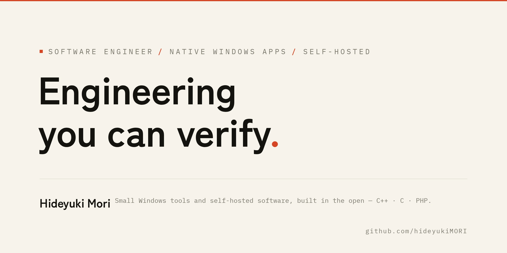
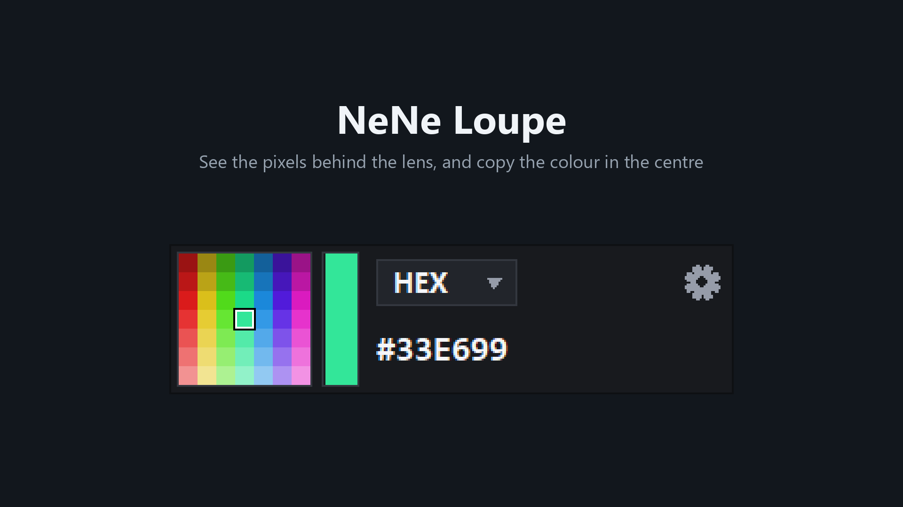
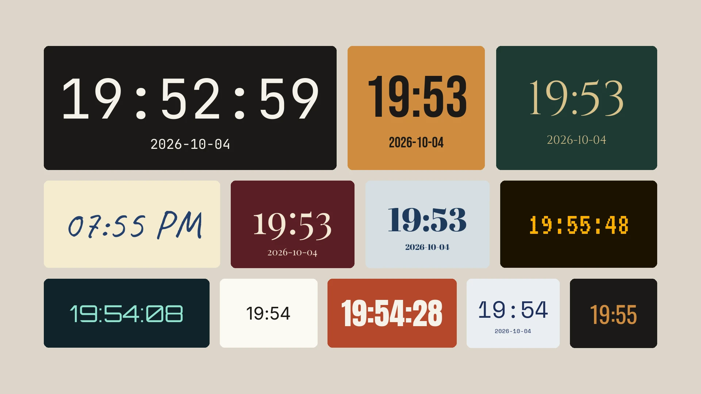

<picture>
  <source media="(prefers-color-scheme: dark)"  srcset="assets/hero-dark.webp">
  <source media="(prefers-color-scheme: light)" srcset="assets/hero-light.webp">
  
</picture>

# Hideyuki Mori

### Software engineer. I build small Windows desktop tools and self-hosted business software in the open, and I put the proof next to every claim.

These days most of my open-source time goes into **native Windows applications** — small, frameless, single-purpose tools written without a UI library. The one I am working on hardest right now is **[NeNe Nib](#nene-nib--a-fast-text-editor-that-toggles-between-ordinary-and-vim-editing)**, a text editor. Alongside them I maintain the **NENE2 series** of self-hosted business software. Everything below is public and checkable: the code, the tests, the releases, and the architecture decisions.

日本語: ソフトウェアエンジニア。いまは Windows 向けの小さなネイティブアプリ（UI ライブラリを使わない、枠なし・単機能の道具）を中心に公開開発しています。いちばん力を入れているのはテキストエディタ「NeNe Nib」です。あわせて、自己ホスト型業務ツール群「NENE2 シリーズ」を保守しています。このページの数字はすべてリンク先で確かめられます。

---

## NeNe Nib — a fast text editor that toggles between ordinary and Vim editing

**[github.com/hideyukiMORI/nene-nib](https://github.com/hideyukiMORI/nene-nib)** · Windows 11 x64 · **Beta — [download v0.1.0-beta.2](https://github.com/hideyukiMORI/nene-nib/releases/tag/v0.1.0-beta.2)** (a 0.6 MB ZIP with `SHA256SUMS`; extract and run `NeNeNib.exe`, no installer and no runtime)

One executable. C++23, plain Win32, Direct2D and DirectWrite — no UI library, no runtime dependency. It edits like Notepad until you flip one switch in the status bar; then it is Vim.

| | |
| --- | --- |
| **Two ways to edit, one toggle** | Ordinary editing (selection, clipboard, undo/redo, mouse) or Vim NORMAL / INSERT / VISUAL — motions, operators, counts, text objects, registers, macros, `.` repeat, blockwise VISUAL, search with highlighting. |
| **A Vim engine written from scratch, checked against real Vim** | **1,853 fixtures generated by Vim 9.1** are replayed in the test suite, plus 78 more for movement in wrapped text. What is not implemented yet is listed in the README, command by command. |
| **Japanese from day one** | IME composition drawn in place; Vim NORMAL turns the IME off and INSERT turns it back on. UTF-8, UTF-8 BOM, and Shift_JIS; CRLF / LF kept as read. |
| **Tabs and Ctrl+P** | Tabs live in the title bar and come back on the next start with caret and scroll position. Ctrl+P fuzzy-finds open tabs, bookmarks, recently closed files, and files in the current folder. Drop files from Explorer to open them. |
| **Look** | Frameless window with a Mica title bar, follows the OS light / dark theme. **95 built-in colour schemes** (`:colorscheme`), plus user themes. Line wrapping, font size on Ctrl + wheel. |
| **Speed, measured** | On the reference machine: startup 191 ms, window visible 35 ms, one keystroke 0.9 ms, a 16 MiB file opens in 250 ms. The benchmark script and reference values are in the repo. |
| **Not yet** | Markdown preview, files above 64 MiB, syntax highlighting, `:s` / `:g`, split windows. No code signing, installer, or auto-update in the beta. |

Every feature is one numbered requirement in [`SPECIFICATION.md`](https://github.com/hideyukiMORI/nene-nib/blob/main/SPECIFICATION.md); the decisions are in [`docs/adr/`](https://github.com/hideyukiMORI/nene-nib/tree/main/docs/adr) and the measurements in [`docs/quality/gate-proofs.md`](https://github.com/hideyukiMORI/nene-nib/blob/main/docs/quality/gate-proofs.md).

---

## More Windows apps

Small, single-purpose tools. No UI library, no runtime to install. Snapshot: October 2026.

  
  &nbsp;
  

| App | What it is | Built with | Status |
| --- | --- | --- | --- |
| **[NeNe Loupe](https://github.com/hideyukiMORI/nene-loupe)** | A tiny frameless screen loupe and colour picker. See the pixels behind the lens, copy the colour in the centre. | C++23 · Win32 | **On the [Microsoft Store](https://apps.microsoft.com/detail/9N6HZB1SXKBM)** · [v1.0.0](https://github.com/hideyukiMORI/nene-loupe/releases/latest) · portable ZIP also available |
| **[NeNe Clock](https://github.com/hideyukiMORI/nene-clock)** | A quiet desktop clock. No frame, no buttons, no tray icon — just the time, in the typeface and colours you choose. | Java 21 · Swing | [v0.2.6](https://github.com/hideyukiMORI/nene-clock/releases/latest) — Windows installer, portable ZIP, Ubuntu `.deb` · Microsoft Store listing in preparation |
| **[NeNe Folio](https://github.com/hideyukiMORI/nene-folio)** | A frameless Markdown notebook with a category drawer. View and edit, a short history of every save, search and regex replace, Vim-like keys; UI in 日本語 / English / 简体中文. | C23 · Win32 | v0.1.0 — usable from source · no packaged download yet |
| **[NeNe Commander](https://github.com/hideyukiMORI/NeNeCommander)** | A keyboard-first dual-pane file manager; Windows, UNC, and WSL paths as typed, explicit boundaries. | C# · .NET 10 · WinUI 3 | In development — most of the MVP scope is on `main` · no download yet |

**How they are built.** Each repository starts from a specification, an architecture constitution, and a test strategy before the first feature. The rule is the same in every one: *every meaning has exactly one canonical implementation path, and the compiler, the build graph, static analysis, and CI enforce that — not memory.*

Also outside the web stack: **[NENE-PIXEL](https://github.com/hideyukiMORI/NENE-PIXEL)** (Kotlin · Android — pixel drawing tool with indexed palettes and up to 16 layers, in development) · **[xi-tools](https://github.com/hideyukiMORI/xi-tools)** (Rust — `scopegrep`, `fleet-top`) · **[nene-recall](https://github.com/hideyukiMORI/nene-recall)** (Go · pgvector — local hybrid retrieval API)

---

## At a glance

Numbers are **measured, not claimed** — each links to where you can check it yourself. Snapshot: October 2026.

| | |
| --- | --- |
| **Shipped** | [NeNe Nib beta](https://github.com/hideyukiMORI/nene-nib/releases/tag/v0.1.0-beta.2) · [NeNe Loupe on the Microsoft Store](https://apps.microsoft.com/detail/9N6HZB1SXKBM) · [NeNe Clock installers](https://github.com/hideyukiMORI/nene-clock/releases/latest) |
| **Scale** | **10,900+ merged PRs** across my own repositories ([verify](https://github.com/search?q=is%3Apr+is%3Amerged+author%3AhideyukiMORI+owner%3AhideyukiMORI&type=pullrequests)) · **42 public repos** |
| **Languages** | C++23 · C23 · Java 21 · C# · Kotlin · Rust · Go · PHP 8.4 · Python 3.14 · TypeScript |
| **Background** | 25 years of JavaScript and 20 years of PHP as a working engineer, from customer hearings through design, implementation, and operation |

---

## NENE2 series — status

MIT-licensed, self-hosted business software on one design language: OpenAPI-first JSON APIs, RFC 9457 Problem Details, MCP-ready boundaries.

| | What it is | Status |
| --- | --- | --- |
| **[NENE2](https://github.com/hideyukiMORI/NENE2)** | PHP 8.4 micro-framework — OpenAPI, MCP catalog, PHPStan level 8 | [v1.12.0](https://github.com/hideyukiMORI/NENE2/releases) · `composer require hideyukimori/nene2` |
| **[nene2-python](https://github.com/hideyukiMORI/nene2-python)** | The same architecture on FastAPI — `mypy --strict` | [v1.8.164](https://github.com/hideyukiMORI/nene2-python/releases) · `uv add nene2-python` |
| **[NeNe Records](https://github.com/hideyukiMORI/nene-records)** | Headless CMS — typed entities, React admin, multi-tenant | Production SaaS at [nene-records.com](https://nene-records.com) · [v0.5.4](https://github.com/hideyukiMORI/nene-records/releases) |
| **[NeNe Invoice](https://github.com/hideyukiMORI/nene-invoice)** | 見積・請求・入金 — 適格請求書 PDF | [v1.0.0](https://github.com/hideyukiMORI/nene-invoice/releases) · [live demo](https://invoice.ayane.co.jp/demo/kensetsu) |
| **[NeNe Corpus](https://github.com/hideyukiMORI/nene-corpus)** | Knowledge chat with citations | Live at [nene-corpus.com](https://nene-corpus.com) |
| **[NeNe Contact](https://github.com/hideyukiMORI/nene-contact)** | Embeddable contact forms | In production |

Other repositories in the series, working but earlier: [nene2-node](https://github.com/hideyukiMORI/nene2-node) · [NeNe](https://github.com/hideyukiMORI/NeNe) · [Concierge](https://github.com/hideyukiMORI/nene-concierge) · [Serve](https://github.com/hideyukiMORI/nene-serve) · [Clear](https://github.com/hideyukiMORI/nene-clear) · [Vault](https://github.com/hideyukiMORI/nene-vault) · [Profile](https://github.com/hideyukiMORI/nene-profile) · [Deal](https://github.com/hideyukiMORI/nene-deal) · [Payout](https://github.com/hideyukiMORI/nene-payout) · [Field](https://github.com/hideyukiMORI/nene-field) · [Suite](https://github.com/hideyukiMORI/nene-suite) · [nene2-js](https://github.com/hideyukiMORI/nene2-js) · [nene-mcp](https://github.com/hideyukiMORI/nene-mcp) · [fleet tooling](https://github.com/hideyukiMORI/nene2-fleet-tooling)

Security testing across the series is maintainer-run self-assessment against isolated environments; it is not a third-party penetration test.

---

## Articles

I write about what actually broke and what fixed it — [DEV](https://dev.to/hideyukimori) · [Zenn](https://zenn.dev/xioncc) · [Qiita](https://qiita.com/xioncc).

**Featured**

*English*
- [I built a tiny PHP framework for AI-readable business APIs](https://dev.to/hideyukimori/i-built-a-tiny-php-framework-for-ai-readable-business-apis-48eo) — DEV
- [MCP should not mean letting AI touch your database](https://dev.to/hideyukimori/mcp-should-not-mean-letting-ai-touch-your-database-57p1) — DEV
- [A todo.txt shared by a human and AI agents](https://dev.to/hideyukimori/a-todotxt-shared-by-a-human-and-ai-agents-why-plain-text-beat-a-saas-board-for-my-workflow-5dbh) — DEV

*日本語*
- [テストが全部緑でも壊せる｜リリース前アドバーサリアルレビューを常設する](https://zenn.dev/xioncc/articles/349a739826288b) — Zenn
- [コンテキストが溢れる AI 協働を multi-session で回す｜指揮×担当を指示書と報告書で受け渡す](https://zenn.dev/xioncc/articles/4445ac86600d28) — Zenn
- [レガシー PHP フレームワークの改修（NeNe）](https://zenn.dev/xioncc/articles/a2709df3e0de3b) — Zenn

**Latest** <!-- auto-updated from the nene-articles pipeline · do NOT hand-edit between the markers below -->
<!-- ARTICLES:START -->
- [Two AI Agents Shared a Todo File and a Line Vanished](https://dev.to/hideyukimori/two-ai-agents-shared-a-todo-file-and-a-line-vanished-22jd) — DEV (en) · 2026-08-08
- [適用ゼロで codemod の非冪等バグを見つけた──撃つ前の机上 dry-run](https://zenn.dev/xioncc/articles/codemod-desk-check-idempotence) — Zenn (ja) · 2026-08-07
- [target="_blank"がハイドレーション後だけ消える｜SSR/SPA二重sanitizerの罠](https://qiita.com/xioncc/items/32c9220145e116263023) — Qiita (ja) · 2026-08-06
- [AI への作業指示書は4日で腐る──着手前の再実測が空撃ちを防いだ](https://zenn.dev/xioncc/articles/stale-orders-subordinate-verifies) — Zenn (ja) · 2026-08-05
- [緑の PR を 11 秒差でマージしたら main が赤になった話｜PR CI は統合後の main を検証しない](https://qiita.com/xioncc/items/d26f17c566a6139f4aff) — Qiita (ja) · 2026-08-05
<!-- ARTICLES:END -->

Featured = hand-picked · Latest = newest 5 (max 2 per platform).

---

Issues are open on every repository above.
