<picture>
  <source media="(prefers-color-scheme: dark)"  srcset="assets/hero-dark.webp">
  <source media="(prefers-color-scheme: light)" srcset="assets/hero-light.webp">
  
</picture>

# Hideyuki Mori

### Software engineer. I build small Windows desktop tools, terminal apps, and self-hosted business software in the open, and I put the proof next to every claim.

**NeNe Nib 1.2.0 is out.** [NeNe Nib](https://apps.microsoft.com/detail/9NCLGDTFQ529) is a 5 MB text editor for Windows 11: write like in Notepad, or press `Ctrl+Shift+Space` for a real Vim. It shows a 16 MiB file in **117 ms — Windows Notepad takes 908 ms** on the same PC ([how it was measured](https://dev.to/hideyukimori/117-ms-vs-908-ms-timing-my-text-editor-against-windows-notepad-5f57)). Version 1.2.0 adds optional caret motion and typing sparks.

**Five apps on the Microsoft Store:** Nib, **[NeNe Folio](https://apps.microsoft.com/detail/9PCHS225SWBX)** (a Markdown notebook in plain C, 1.5.0), NeNe Loupe, NeNe Clock and NeNe Ruler.

My current work spans **Windows desktop tools**, **Swift terminal apps for WSL2**, and the **NENE2 family of self-hosted business software**. **[NeNe Commander](https://github.com/hideyukiMORI/NeNeCommander)**, a keyboard-first dual-pane file manager in C# / WinUI 3, is at its fifth preview, **[beta.5](https://github.com/hideyukiMORI/NeNeCommander/releases/tag/v0.1.0-beta.5)** (25 November). **[NeNe Ledger](https://github.com/hideyukiMORI/nene-ledger)**, a CSV / TSV editor in Rust, is at **[preview.3](https://github.com/hideyukiMORI/nene-ledger/releases/tag/v0.1.0-preview.3)**. Every project, with real screens and numbers, is on my portfolio: **[hideyuki-mori.com](https://hideyuki-mori.com/)**. The links below distinguish released software from work in progress.

日本語: ソフトウェアエンジニア。<strong>テキストエディタ NeNe Nib の 1.2.0 を公開しました。</strong>メモ帳のように書けて、<code>Ctrl+Shift+Space</code> で本物の Vim の操作に切り替わる、約 5 MB の Windows 11 用エディタです。16 MiB のファイルを <strong>117 ms</strong> で表示します（同じ PC でメモ帳は 908 ms）。1.2.0 では、キャレットが滑らかに動く機能と、打つたびに粒が弾ける機能を足しました（どちらも既定はオフ）。Microsoft Store では Nib・Folio・Loupe・Clock・Ruler の 5 本を公開しています。2 画面のファイルマネージャ NeNe Commander は 11 月 25 日にプレビュー版 beta.5 を公開。作品の一覧は <a href="https://hideyuki-mori.com/">hideyuki-mori.com</a> にあります。

Repository and release status checked: 27 November 2026.

---

## NeNe Nib — a 5 MB text editor for Windows 11: Notepad, or a real Vim, one key apart

[Source code](https://github.com/hideyukiMORI/nene-nib) · Windows 11 x64 · Free · **1.2.0** on the Store (signed and delivered by Microsoft) and on GitHub as **[v1.2.0](https://github.com/hideyukiMORI/nene-nib/releases/tag/v1.2.0)**. One executable, no installer and no runtime.

  <a href="https://dev.to/hideyukimori/117-ms-vs-908-ms-timing-my-text-editor-against-windows-notepad-5f57">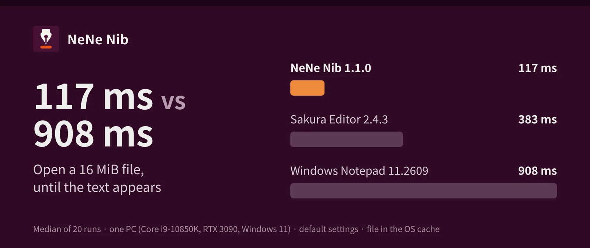</a>

Measured from outside the apps by recording the screen at 60 fps and counting frames. Medians of 20 runs for time and 10 for memory.

| | NeNe Nib 1.1.0 | Sakura Editor 2.4.3 | Windows Notepad 11.2609 |
| --- | ---: | ---: | ---: |
| Open a 200-line file, until text appears | **100 ms** | 267 ms | 450 ms |
| Open a 16 MiB file, until text appears | **117 ms** | 383 ms | 908 ms |
| RAM after opening 200 lines | 14.1 MiB | **11.6 MiB** | 40.4 MiB |
| RAM after opening 16 MiB | **30.4 MiB** | 54.2 MiB | 88.7 MiB |
| Package size | **4.75 MB** | 5.62 MB | 18.55 MB |

One PC (Core i9-10850K, RTX 3090, Windows 11), default settings, the same window size, files in the OS cache. RAM is the private working set. Sakura Editor is 3.61 MB without its help files. Notepad's size excludes the runtimes it needs. <a href="https://github.com/hideyukiMORI/nene-nib/blob/main/docs/quality/editor-comparison-2026-11-23.md">Measurement record</a>.

  
  &nbsp;
  
  &nbsp;
  

Videos: the 28-second introduction · caret motion in 1.2.0 (61 s) · Nib vs Notepad opening a 16 MiB file (10 s).

### Why Nib

- **Fast.** Text is on screen 100 ms after launch, and a 16 MiB file opens in 117 ms: 4.5× and 7.8× faster than Windows Notepad on the same PC.
- **Small and light.** One 5.1 MB executable (5,089,792 bytes in 1.2.0). After opening a 16 MiB file, it used about a third of the memory Notepad used.
- **Notepad or Vim, one key apart.** Edit the ordinary Windows way, or switch to a Vim written from scratch and replayed against real Vim 9.1 in thousands of tests.
- **Ready for code when you want it.** Connect a language server (off by default) for diagnostics, completion, hover, go-to-definition, references, symbols, parameter info, formatting and rename.
- **Made for large files.** UTF-8 files up to 1 GiB are read in the background, and a giant single line can be shown as a grid.
- **Find anything.** `Ctrl+P` lists tabs, bookmarks, recent files and folder files; `Ctrl+Shift+F` searches a whole project, with a preview of each hit.
- **Good with Japanese.** Japanese IME drawn in place, Shift_JIS, UTF-8 and UTF-16, and a Japanese, English or Simplified Chinese interface.
- **Private.** No account, no personal information collected, and no network connections of its own.

  <a href="https://apps.microsoft.com/detail/9NCLGDTFQ529">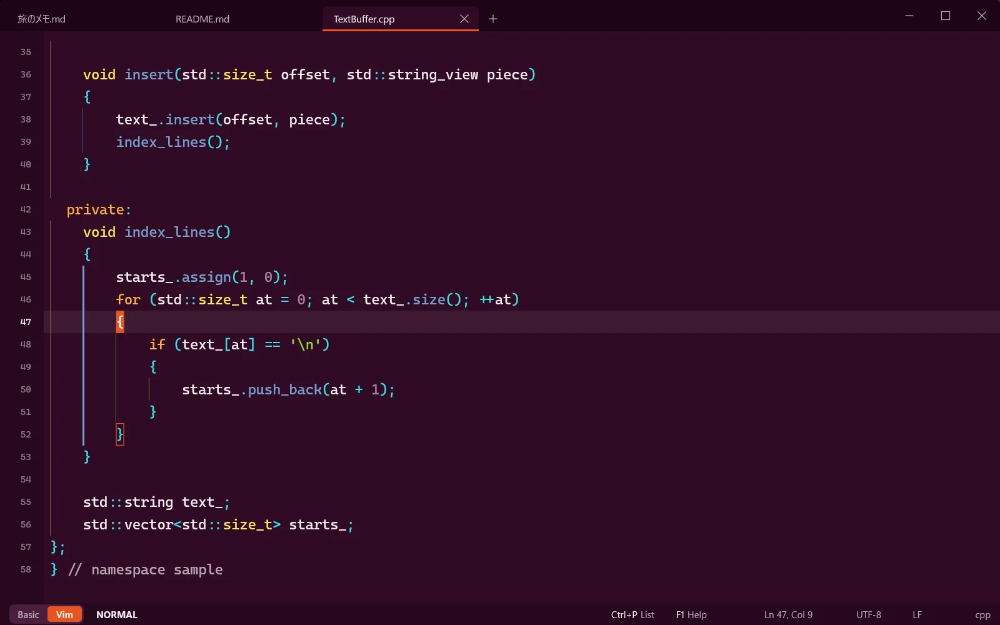</a>

  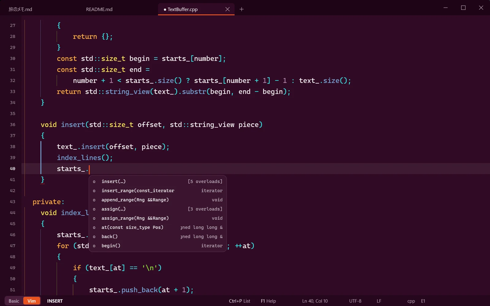
  &nbsp;
  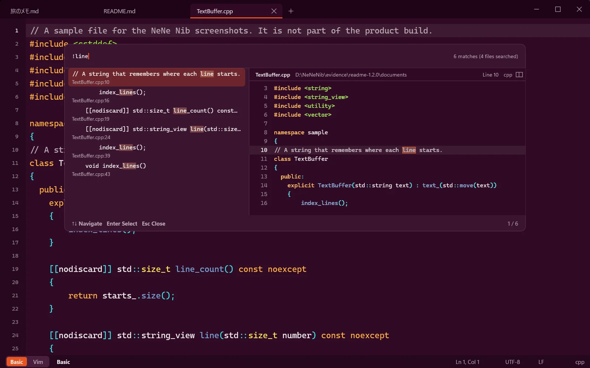

Real windows of NeNe Nib 1.2.0 from the repository's <code>docs/images</code>.

### New in 1.2.0: caret motion and typing sparks

  <a href="https://youtu.be/hyy7_ePLoRg">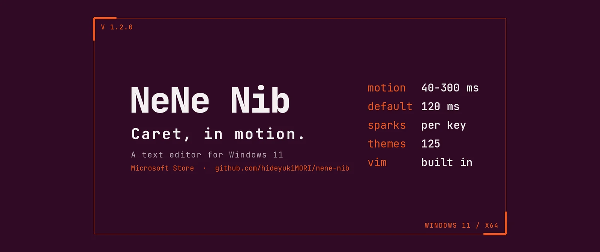</a>

- **The caret glides** to where it is going instead of jumping. Its four corners arrive one after another, so it leaves a short trail. Choose the time from 40 to 300 ms (`:set caretmotiontime=`, 120 ms by default).
- **Typing never waits for it.** The motion is drawn on top of the text, and a new move starts from where the caret is drawn, so fast typing stays one continuous movement.
- **Sparks** (`:set caretsparks`) throw a small burst in your theme's colours on every keystroke.
- **Both are off by default.** They pause while the IME is composing and follow the Windows animation-effects setting.
- Also in 1.2.0: resizable split panes, indent guides, font sizes in steps of 0.5 pt, and a clearer settings drawer.

### Colour themes

  

Eight favourites out of **125 built-in colour schemes** — the 28 standard Vim names, VS Code defaults and popular IDE palettes, MonaLisa, and film-inspired originals. Switch with `:colorscheme <name>` or from Ctrl+P. [All theme names and sources](https://github.com/hideyukiMORI/nene-nib/blob/main/docs/design/2026-10-12-colorschemes.md) · [offline gallery (HTML)](https://github.com/hideyukiMORI/nene-nib/blob/main/docs/design/colorschemes.html)

The image shows colour samples, not application screenshots. All 125 schemes ship in every release.

| | |
| --- | --- |
| **A Vim engine written from scratch, checked against real Vim** | **6,892 fixtures generated by Vim 9.1** and 402 wrapped-text fixtures are replayed by CTest, and a differential fuzzer with fixed seeds keeps finding and fixing differences. Motions, operators, counts, text objects, registers, macros, marks, `.` repeat, blockwise VISUAL, `:s`, `:g`, `map`. |
| **Speed, gated** | Inside the app, on the reference machine: first frame 41.9 ms, one keystroke 0.64 ms, a 16 MiB file opened in 49.8 ms. A speed gate of eight benchmarks runs before every release; the script and reference values are in the repo. (The 117 ms above is measured from outside, from launch to text on screen.) |
| **Tabs, splits and Ctrl+P** | Tabs live in the title bar and come back on the next start with caret and scroll position. Resizable two-pane splits and a folder explorer. F1 lists every editor command. |
| **Syntax and Markdown** | Syntax colours for 25 languages, rainbow indent guides, and a Markdown preview with tables, alerts, task lists and coloured code blocks. |
| **Safe by default** | Autosave every 30 seconds, plus a last-resort backup before an uncaught exception ends the process; both are offered back on the next start. |
| **Not yet** | Uppercase marks (`'A`–`'Z`) and `:marks`, `:sort` and the other `:g` / `:v` commands. Commentary, surround and auto-pairs are planned. |

Every feature is one numbered requirement in [`SPECIFICATION.md`](https://github.com/hideyukiMORI/nene-nib/blob/main/SPECIFICATION.md); the decisions are in [`docs/adr/`](https://github.com/hideyukiMORI/nene-nib/tree/main/docs/adr).

**Written about Nib:** [117 ms vs 908 ms: Timing My Text Editor Against Windows Notepad](https://dev.to/hideyukimori/117-ms-vs-908-ms-timing-my-text-editor-against-windows-notepad-5f57) · [A Caret That Glides in 120 ms Without Slowing Your Typing](https://dev.to/hideyukimori/a-caret-that-glides-in-120-ms-without-slowing-your-typing-4ma7) · [I Built a 4.4 MB Windows Text Editor That Switches Between Notepad-Style Editing and Vim](https://dev.to/hideyukimori/i-built-a-44-mb-windows-text-editor-that-switches-between-notepad-style-editing-and-vim-31o) — DEV · [NeNe Nib・サクラエディタ・メモ帳の起動を同じ条件で測りました](https://zenn.dev/xioncc/articles/nene-nib-editor-speed-comparison) · [キャレットが滑らかに動くテキストエディタ NeNe Nib 1.2.0：打つ速さはそのまま](https://zenn.dev/xioncc/articles/nene-nib-caret-motion) — Zenn · [本物の Vim と 6,892 件照合した](https://qiita.com/xioncc/items/bea993135a587a2e5a28) — Qiita

---

## NeNe Folio — now on the Microsoft Store

**[Get NeNe Folio from the Microsoft Store](https://apps.microsoft.com/detail/9PCHS225SWBX?hl=ja-jp&gl=JP)** · [Source code](https://github.com/hideyukiMORI/nene-folio) · Windows 10 version 2004 or later, x64 · Free

A frameless Markdown notebook for everyday notes, reading logs and ideas. Organize notes in coloured categories, edit the Markdown source, and switch to a readable view of headings, lists, tables, quotes and code blocks. Written in **C23 and Win32, without a UI library**.

  

Application screenshot from the repository's v0.2.0 showcase. See the Store listing for the current release.

- **Keep your notes as files.** Markdown in a folder you choose; no account, ads or usage tracking.
- **Find and organize.** Search note names and bodies, search within a note, use regex replacement, and drag notes into order.
- **Recover an earlier draft.** Keep up to five pre-save versions and restore one into the editor.
- **Make it comfortable.** Preview themes, zoom the note, choose list / note / combined views, and use keyboard commands. 日本語 / English / 简体中文 UI.
- **Diagrams and images (1.3).** Mermaid flowcharts and sequence diagrams rendered in the note's theme, PNG / JPEG images, syntax colours in code blocks, and ZIP export that bundles referenced images. Pasting is always plain text.
- **Favourites, tags and a finder (1.4.0).** Star notes to keep them at the top of a category, tag them (stored in front matter) and filter with AND / OR. Ctrl+O finds notes by name or body and shows the first match with its line. Right-click menus in the note, a copy button on code blocks, and the window reopens where you left it. Markdown gains bare-URL links, reference-style links and footnotes; Mermaid gains **state, ER and class diagrams**.
- **Outline and more diagrams (1.5.0).** A **heading outline** beside the reading view (Ctrl+Shift+O) marks where you are and jumps on click or with the keyboard, and reads as a nested list to screen readers. Move a note to another category from the list, keyboard control in the finder, definition lists, footnotes that link both ways, and Mermaid **pie charts and Gantt charts**. Note, ledger and settings formats are unchanged from 1.4.0.

The **Store app is the main download** and is at **1.5.0** (published 19 November 2026). The same version is also on GitHub as an **[unsigned portable ZIP](https://github.com/hideyukiMORI/nene-folio/releases/tag/v1.5.0)** (a Beta pre-release) with `SHA256SUMS` for people who prefer not to use the Store. Not yet: other Mermaid types such as journey, indented code blocks, and ticking task boxes in the reading view.

---

## More Windows apps

Desktop tools with different native stacks, from plain Win32 to Swing and WinUI. **NeNe Nib, NeNe Folio, NeNe Loupe, NeNe Clock and NeNe Ruler are on the Microsoft Store.**

  <a href="https://apps.microsoft.com/detail/9N6HZB1SXKBM">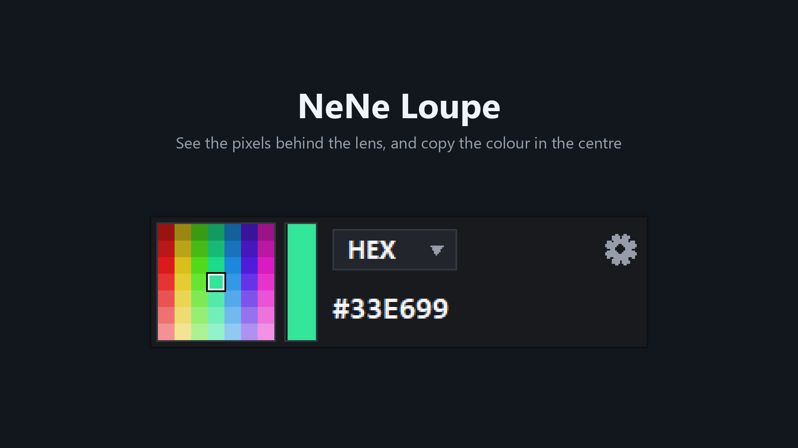</a>
  &nbsp;
  
  &nbsp;
  <a href="https://github.com/hideyukiMORI/nene-ruler">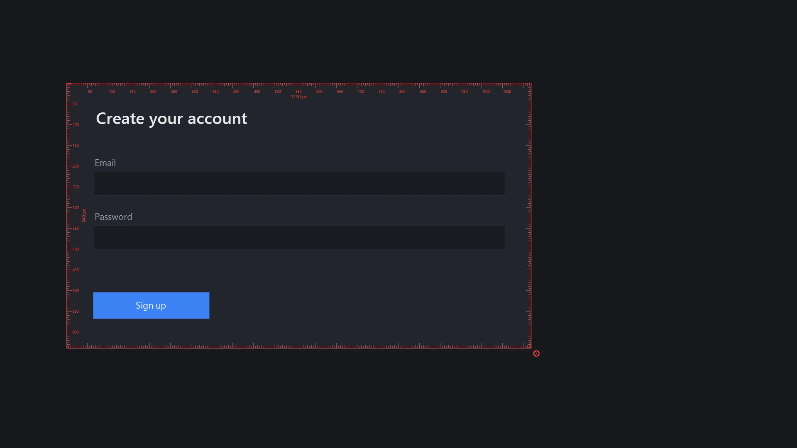</a>

| App | What it is | Built with | Status |
| --- | --- | --- | --- |
| **[NeNe Loupe](https://github.com/hideyukiMORI/nene-loupe)** | A tiny frameless screen loupe and colour picker. See the pixels behind the lens, copy the colour in the centre. | C++23 · Win32 | **On the [Microsoft Store](https://apps.microsoft.com/detail/9N6HZB1SXKBM)** · [v1.0.0](https://github.com/hideyukiMORI/nene-loupe/releases/latest) · portable ZIP also available |
| **[NeNe Clock](https://github.com/hideyukiMORI/nene-clock)** | A quiet desktop clock. No frame, no buttons, no tray icon — just the time, in the typeface and colours you choose. | Java 21 · Swing (runtime bundled) | **On the [Microsoft Store](https://apps.microsoft.com/detail/9N5G1ZXK0MV7)** · [latest release](https://github.com/hideyukiMORI/nene-clock/releases/latest) — Windows installer, portable ZIP, Ubuntu `.deb` |
| **[NeNe Ruler](https://github.com/hideyukiMORI/nene-ruler)** | A frameless on-screen ruler. Lay a transparent frame over anything and read its width and height in physical pixels; click a number to copy it. | Rust · Win32 + Direct2D (Linux: x11rb + cairo) | **On the [Microsoft Store](https://apps.microsoft.com/detail/9N6JVHKL9LM3)** · [latest release](https://github.com/hideyukiMORI/nene-ruler/releases/latest) — Windows MSI, portable ZIP, Ubuntu `.deb`, Linux ZIP |
| **[NeNe Nib](https://github.com/hideyukiMORI/nene-nib)** | A 5 MB text editor that switches between ordinary (Notepad-style) and Vim editing; opens a 16 MiB file in 117 ms; language servers, project search, Markdown preview, 125 colour schemes, optional caret motion. [More above](#nene-nib--a-5-mb-text-editor-for-windows-11-notepad-or-a-real-vim-one-key-apart). | C++23 · Win32 + Direct2D | **On the [Microsoft Store](https://apps.microsoft.com/detail/9NCLGDTFQ529)** (1.2.0) · [v1.2.0](https://github.com/hideyukiMORI/nene-nib/releases/tag/v1.2.0) on GitHub |
| **[NeNe Folio](https://github.com/hideyukiMORI/nene-folio)** | A frameless Markdown notebook with a category drawer. View and edit (tables, nested lists, checklists, footnotes), favourites and tags, a heading outline, Mermaid diagrams and images, a short history of every save, search and regex replace, Vim-like keys; UI in 日本語 / English / 简体中文. | C23 · Win32 | **On the [Microsoft Store](https://apps.microsoft.com/detail/9PCHS225SWBX)** (1.5.0) · [v1.5.0 portable ZIP](https://github.com/hideyukiMORI/nene-folio/releases/tag/v1.5.0) on GitHub |
| **[NeNe Commander](https://github.com/hideyukiMORI/NeNeCommander)** | A keyboard-first dual-pane file manager with Vim-style keys: copy, move, rename and delete with progress and cancel, a command palette, bookmarks, and a drive / WSL list. Windows, WSL and UNC paths are separate, explicit boundaries; files move between Windows and WSL distributions. | C# · .NET 10 · WinUI 3 | **Preview — [0.1.0-beta.5](https://github.com/hideyukiMORI/NeNeCommander/releases/tag/v0.1.0-beta.5)** (25 November · Windows 11 x64 ZIP, unsigned, runtimes bundled) — writing to UNC / network drives not yet; back up important files before trying it |
| **[NeNe Docket](https://github.com/hideyukiMORI/NeNeDocket)** | A folder-based issue tracker with undo, per-account journals, history and optional signed permissions; no server. | Rust · Win32 + Direct2D / x11rb + cairo | In development — runs on X11, and on Windows 11 with a shared folder on a NAS (checked on the owner's machine, 16 November) · no release yet |
| **[NeNe Ledger](https://github.com/hideyukiMORI/nene-ledger)** | A CSV / TSV editor that stays fast on huge files and never changes data on its own: cells are text (`00123` stays `00123`), untouched rows are written back byte for byte, heavy work runs in the background. | Rust · Win32 + Direct2D / x11rb + cairo | **Preview — [0.1.0-preview.3](https://github.com/hideyukiMORI/nene-ledger/releases/tag/v0.1.0-preview.3)** (15 November · Windows x64 ZIP, unsigned) — opens 1 GB / 12 million rows at once, edits cells and rows with undo, saves, pastes ranges from Excel, find / replace with regex, edits long values in a formula-bar-style pane, a command palette; sorting, filtering and non-Japanese UI not yet · custom licence (free use, no sale) |

**How they are built.** Each repository starts from a specification, an architecture constitution, and a test strategy before the first feature. The rule is the same in every one: *every meaning has exactly one canonical implementation path, and the compiler, the build graph, static analysis, and CI enforce that — not memory.*

Also outside the web stack: **[NENE-PIXEL](https://github.com/hideyukiMORI/NENE-PIXEL)** (Kotlin · Android — pixel drawing tool with indexed palettes and up to 16 layers, in development) · **[xi-tools](https://github.com/hideyukiMORI/xi-tools)** (Rust — `scopegrep`, `fleet-top`) · **[nene-recall](https://github.com/hideyukiMORI/nene-recall)** (Go · pgvector — local hybrid retrieval API)

---

## Terminal apps in Swift for WSL2

Terminal apps for Ubuntu on WSL2 in Windows Terminal: AI-played game screensavers, an interactive falling-sand game, and a news ticker. The game screensavers pair hand-written AIs with character banter; Wire fetches headlines and can translate them locally. Eight apps have published releases; Delve and Summit are still in development.

  <a href="https://github.com/hideyukiMORI/nene-gambit">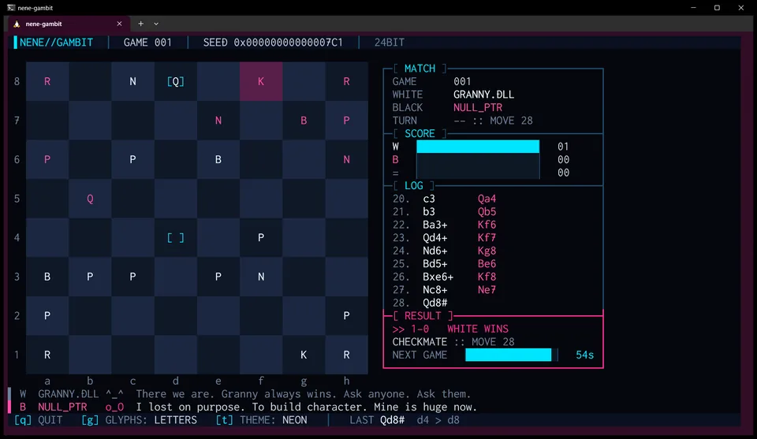</a>
  &nbsp;
  <a href="https://github.com/hideyukiMORI/nene-swarm">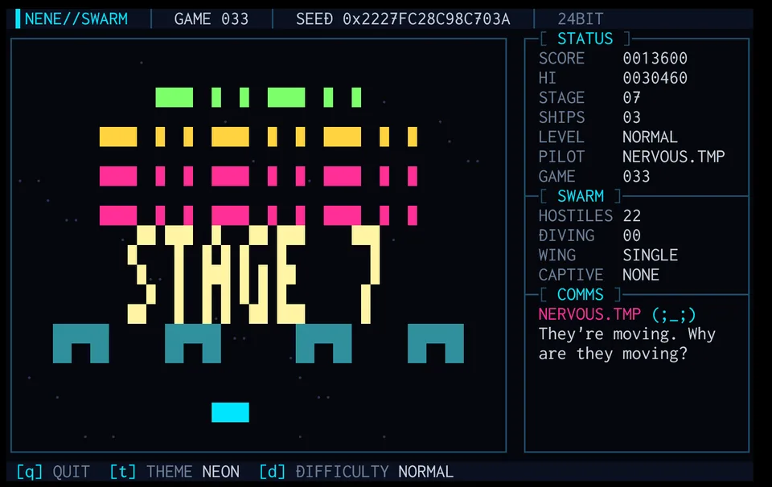</a>
  &nbsp;
  <a href="https://github.com/hideyukiMORI/nene-bolt">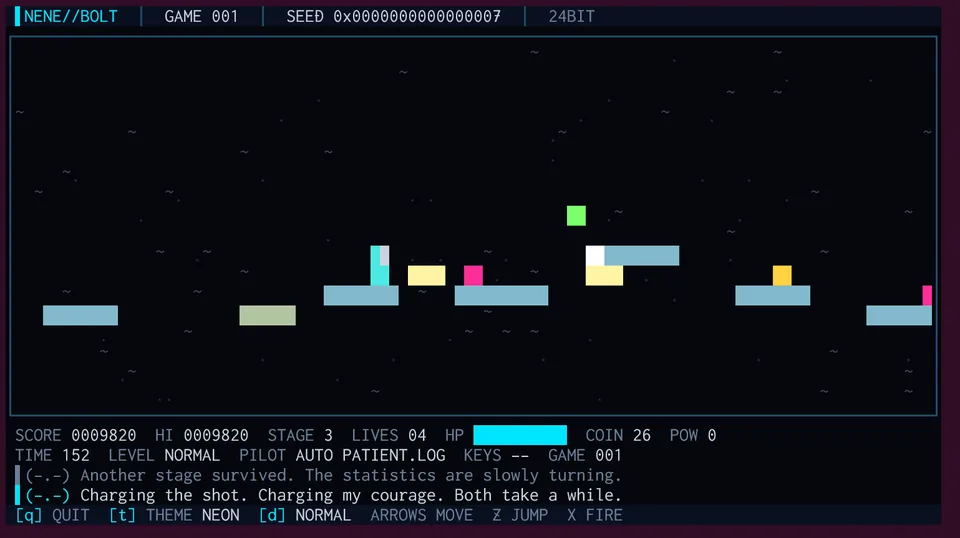</a>

  
  &nbsp;
  <a href="https://github.com/hideyukiMORI/nene-poker">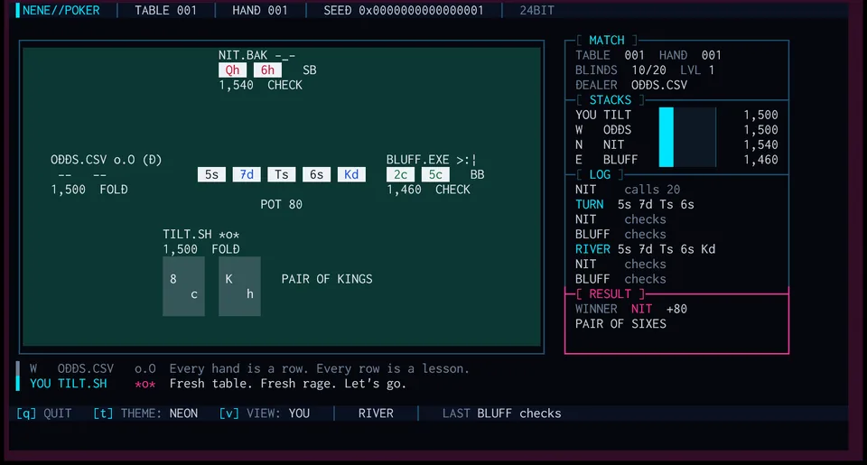</a>
  &nbsp;
  

Screenshots from each repository, taken in Windows Terminal on WSL2.

| App | What it is | Status |
| --- | --- | --- |
| **[NeNe Gambit](https://github.com/hideyukiMORI/nene-gambit)** | Chess. A hand-written chess AI plays game after game; same `--seed`, same games, same banter. | [v0.1.1](https://github.com/hideyukiMORI/nene-gambit/releases/latest) |
| **[NeNe Reversi](https://github.com/hideyukiMORI/nene-reversi)** | Reversi, with commentary on every stolen corner. | [v0.1.0 beta](https://github.com/hideyukiMORI/nene-reversi/releases/latest) |
| **[NeNe Igo](https://github.com/hideyukiMORI/nene-igo)** | Go on a 19×19 board, with a hand-written Monte Carlo tree search. | [v0.1.0](https://github.com/hideyukiMORI/nene-igo/releases/latest) |
| **[NeNe Poker](https://github.com/hideyukiMORI/nene-poker)** | No-limit Texas hold'em at one table of four AIs. Imaginary chips, no money involved. | [v0.1.0](https://github.com/hideyukiMORI/nene-poker/releases/latest) |
| **[NeNe Swarm](https://github.com/hideyukiMORI/nene-swarm)** | A fixed-screen shooter: a marching, diving swarm, shields, a capture beam, bonus stages, a top-five high score. | [v0.1.0 beta](https://github.com/hideyukiMORI/nene-swarm/releases/latest) |
| **[NeNe Bolt](https://github.com/hideyukiMORI/nene-bolt)** | A side-scrolling action platformer, four stages and a boss. Press an arrow key and you take over from the AI. | [v0.1.0 beta](https://github.com/hideyukiMORI/nene-bolt/releases/latest) |
| **[NeNe Sand](https://github.com/hideyukiMORI/nene-sand)** | Not a screensaver: a falling-sand incremental game. Draw with the mouse, discover reactions, sell grains, automate. | [v0.1.0](https://github.com/hideyukiMORI/nene-sand/releases/latest) |
| **[NeNe Wire](https://github.com/hideyukiMORI/nene-wire)** | World and Japanese news in a terminal ticker, optional offline English-to-Japanese translation, saved stories and translations across restarts. | [v0.4.0 beta](https://github.com/hideyukiMORI/nene-wire/releases/tag/v0.4.0) |
| **[NeNe Delve](https://github.com/hideyukiMORI/nene-delve)** | Endless procedurally generated mazes, explored and descended in text, with a pseudo-3D view. | In development — maze types from caves to city blocks and descending floors run from source · no release yet |
| **[NeNe Summit](https://github.com/hideyukiMORI/nene-summit)** | An autonomous mountain-climbing platformer: running, jumping, wall-jumping and air-dashing through original rooms. | In development — one room is playable from source, with an auto-climbing guide and a manual mode · no release yet |

**Install** with one line — `curl -fsSL https://raw.githubusercontent.com/hideyukiMORI/nene-gambit/main/install.sh | bash` (for the released apps, swap the repository name). The script verifies the release against `SHA256SUMS` before it installs anything. Each release is a single Linux x86_64 binary with the Swift standard library linked statically, so Swift is not needed (Ubuntu 22.04+). Swarm, Bolt and Wire also have a PowerShell installer. Wire uses `curl` to fetch news; its optional offline translator needs a separate Python / Argos Translate installation. Delve and Summit do not have release installers yet.

All MIT, with specifications, architecture decisions and documented quality gates. Every Swift app, including Delve and Summit, builds and tests with `make check` locally and in CI. Each repository states what its checks actually enforce.

---

## At a glance

Release status and repository counts checked on **27 November 2026**. Performance measurements retain their original dates and test conditions.

| | |
| --- | --- |
| **Shipped** | **Five Microsoft Store apps:** [Nib](https://apps.microsoft.com/detail/9NCLGDTFQ529), [Folio](https://apps.microsoft.com/detail/9PCHS225SWBX), [Loupe](https://apps.microsoft.com/detail/9N6HZB1SXKBM), [Clock](https://apps.microsoft.com/detail/9N5G1ZXK0MV7), [Ruler](https://apps.microsoft.com/detail/9N6JVHKL9LM3) · **eight released Swift terminal apps**, including [Wire v0.4.0](https://github.com/hideyukiMORI/nene-wire/releases/tag/v0.4.0) · previews of [NeNe Commander beta.5](https://github.com/hideyukiMORI/NeNeCommander/releases/tag/v0.1.0-beta.5) and [NeNe Ledger preview.3](https://github.com/hideyukiMORI/nene-ledger/releases/tag/v0.1.0-preview.3) |
| **Scale** | **13,150+ merged PRs** across my own repositories ([verify](https://github.com/search?q=is%3Apr+is%3Amerged+author%3AhideyukiMORI+owner%3AhideyukiMORI&type=pullrequests)) · **[55 public repositories](https://github.com/hideyukiMORI?tab=repositories&type=public)** |
| **Languages** | C++23 · C23 · Rust · Swift 6 · Java 21 · C# · Kotlin · Go · PHP 8.4 · Python 3.14 · TypeScript |
| **Portfolio** | **[hideyuki-mori.com](https://hideyuki-mori.com/)** — 42 projects with real screens, measured numbers and status, in English and Japanese |
| **Background** | 25 years of JavaScript and 20 years of PHP as a working engineer, from customer hearings through design, implementation, and operation |

---

## NENE2 series — status

MIT-licensed, self-hosted business software on one design language: OpenAPI-first JSON APIs, RFC 9457 Problem Details, MCP-ready boundaries.

| | What it is | Status |
| --- | --- | --- |
| **[NENE2](https://github.com/hideyukiMORI/NENE2)** | PHP 8.4 micro-framework — OpenAPI, MCP catalog, PHPStan level 8 | [v1.12.0](https://github.com/hideyukiMORI/NENE2/releases) · `composer require hideyukimori/nene2` |
| **[nene2-python](https://github.com/hideyukiMORI/nene2-python)** | The same architecture on FastAPI — `mypy --strict` | [v1.8.164](https://github.com/hideyukiMORI/nene2-python/releases) · `uv add nene2-python` |
| **[NeNe Records](https://github.com/hideyukiMORI/nene-records)** | Headless CMS — typed entities, React admin, multi-tenant | Production SaaS at [nene-records.com](https://nene-records.com) · [v0.5.4](https://github.com/hideyukiMORI/nene-records/releases) |
| **[NeNe Invoice](https://github.com/hideyukiMORI/nene-invoice)** | 見積・請求・入金 — 適格請求書 PDF | [v1.0.0](https://github.com/hideyukiMORI/nene-invoice/releases) · [live demo](https://invoice.ayane.co.jp/demo/kensetsu) |
| **[NeNe Corpus](https://github.com/hideyukiMORI/nene-corpus)** | Knowledge chat with citations | Live at [nene-corpus.com](https://nene-corpus.com) |
| **[NeNe Contact](https://github.com/hideyukiMORI/nene-contact)** | Embeddable contact forms | In production |

Recent maintenance includes shared frontend components in [nene2-fleet-tooling](https://github.com/hideyukiMORI/nene2-fleet-tooling) and dependency-audit updates in [NeNe Payout](https://github.com/hideyukiMORI/nene-payout/commits/main/). Payout's vendor-invoice card-payment flow remains **in development**; it is not a released payment service.

Other repositories in the series, at varying stages of development: [nene2-node](https://github.com/hideyukiMORI/nene2-node) · [NeNe](https://github.com/hideyukiMORI/NeNe) · [Concierge](https://github.com/hideyukiMORI/nene-concierge) · [Serve](https://github.com/hideyukiMORI/nene-serve) · [Clear](https://github.com/hideyukiMORI/nene-clear) · [Vault](https://github.com/hideyukiMORI/nene-vault) · [Profile](https://github.com/hideyukiMORI/nene-profile) · [Deal](https://github.com/hideyukiMORI/nene-deal) · [Payout](https://github.com/hideyukiMORI/nene-payout) · [Field](https://github.com/hideyukiMORI/nene-field) · [Suite](https://github.com/hideyukiMORI/nene-suite) · [nene2-js](https://github.com/hideyukiMORI/nene2-js) · [nene-mcp](https://github.com/hideyukiMORI/nene-mcp) · [fleet tooling](https://github.com/hideyukiMORI/nene2-fleet-tooling)

Security testing across the series is maintainer-run self-assessment against isolated environments; it is not a third-party penetration test.

---

## Articles

I write about what actually broke and what fixed it — [DEV](https://dev.to/hideyukimori) · [Zenn](https://zenn.dev/xioncc) · [Qiita](https://qiita.com/xioncc).

**Featured**

*English*
- [117 ms vs 908 ms: Timing My Text Editor Against Windows Notepad](https://dev.to/hideyukimori/117-ms-vs-908-ms-timing-my-text-editor-against-windows-notepad-5f57) — DEV
- [A Caret That Glides in 120 ms Without Slowing Your Typing](https://dev.to/hideyukimori/a-caret-that-glides-in-120-ms-without-slowing-your-typing-4ma7) — DEV
- [I built a tiny PHP framework for AI-readable business APIs](https://dev.to/hideyukimori/i-built-a-tiny-php-framework-for-ai-readable-business-apis-48eo) — DEV
- [MCP should not mean letting AI touch your database](https://dev.to/hideyukimori/mcp-should-not-mean-letting-ai-touch-your-database-57p1) — DEV
- [A todo.txt shared by a human and AI agents](https://dev.to/hideyukimori/a-todotxt-shared-by-a-human-and-ai-agents-why-plain-text-beat-a-saas-board-for-my-workflow-5dbh) — DEV

*日本語*
- [NeNe Nib・サクラエディタ・メモ帳の起動を同じ条件で測りました](https://zenn.dev/xioncc/articles/nene-nib-editor-speed-comparison) — Zenn
- [メモ帳のように使えて Vim にも切り替わる Windows エディタを作り、本物の Vim と 6,892 件照合した](https://qiita.com/xioncc/items/bea993135a587a2e5a28) — Qiita
- [テストが全部緑でも壊せる｜リリース前アドバーサリアルレビューを常設する](https://zenn.dev/xioncc/articles/349a739826288b) — Zenn
- [コンテキストが溢れる AI 協働を multi-session で回す｜指揮×担当を指示書と報告書で受け渡す](https://zenn.dev/xioncc/articles/4445ac86600d28) — Zenn
- [レガシー PHP フレームワークの改修（NeNe）](https://zenn.dev/xioncc/articles/a2709df3e0de3b) — Zenn

**Latest** <!-- auto-updated from the nene-articles pipeline · do NOT hand-edit between the markers below -->
<!-- ARTICLES:START -->
- [Two AI Agents Shared a Todo File and a Line Vanished](https://dev.to/hideyukimori/two-ai-agents-shared-a-todo-file-and-a-line-vanished-22jd) — DEV (en) · 2026-08-08
- [適用ゼロで codemod の非冪等バグを見つけた──撃つ前の机上 dry-run](https://zenn.dev/xioncc/articles/codemod-desk-check-idempotence) — Zenn (ja) · 2026-08-07
- [target="_blank"がハイドレーション後だけ消える｜SSR/SPA二重sanitizerの罠](https://qiita.com/xioncc/items/32c9220145e116263023) — Qiita (ja) · 2026-08-06
- [AI への作業指示書は4日で腐る──着手前の再実測が空撃ちを防いだ](https://zenn.dev/xioncc/articles/stale-orders-subordinate-verifies) — Zenn (ja) · 2026-08-05
- [緑の PR を 11 秒差でマージしたら main が赤になった話｜PR CI は統合後の main を検証しない](https://qiita.com/xioncc/items/d26f17c566a6139f4aff) — Qiita (ja) · 2026-08-05
<!-- ARTICLES:END -->

Featured = hand-picked · Latest = newest 5 (max 2 per platform).

---

Issues are open on every repository above.
